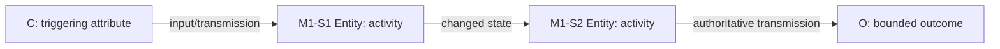

# Writing and visuals

## Analytical paragraph unit

Write mechanism analysis as inference, not plot summary. A strong unit contains:

1. **Function:** what this step must accomplish in the theory.
2. **Condition:** why the entity could act in this case and time window.
3. **Activity:** what was done and to whom/what.
4. **Evidence:** the most diagnostic observations, with source context and IDs.
5. **Transmission:** what changed and how it enabled the next step.
6. **Rival:** whether the same observations are expected under the best alternative.
7. **Update:** bounded conclusion, unresolved issue, and next needed evidence.

Use background only to establish conditions, sequence, or source context. Compress facts that do no causal work.

## Manuscript architecture

1. Puzzle and bounded outcome.
2. Existing explanations and precise gap.
3. Focal mechanism, scope, and rivals.
4. Research design, case selection, sources, and evidence logic.
5. Process reconstruction by mechanism step, not merely by year.
6. Cross-step aggregation and competing explanations.
7. Counterfactual or boundary analysis where warranted.
8. Conclusion: contribution, conclusion ceiling, generalization, and missing evidence.

Keep evidence evaluation near the claim it supports. A comprehensive road map may sit in an appendix, but the main text still explains why key observations are diagnostic.

## Claim style

Prefer:

- “The contemporaneous internal record establishes that actor A raised consideration X; it does not by itself establish that X determined the decision.”
- “E is more expected under H1 than H2 because …, although shared-source dependence limits the update.”
- “The archive search did not recover P3; because relevant files remain closed, this absence does not disconfirm the step.”

Avoid:

- “The timeline proves …”
- “Numerous reports confirm …” without source-family analysis.
- “The alternative is ruled out …” after presenting only focal-theory evidence.
- “This is a smoking gun …” without likelihood and source reasoning.
- vague mechanisms such as “norms mattered,” “pressure worked,” or “institutions shaped behavior.”

## Visual selection

Use the smallest visual that clarifies a relationship:

- **mechanism diagram:** three or more dependent steps;
- **timeline:** sequence, lag, critical juncture, or competing temporal predictions;
- **argument road map:** propositions and supporting evidence across levels;
- **evidence heatmap:** several steps × explanations × evidence strengths;
- **alternative tree:** branching or complementary causal paths;
- **case table:** repeated mappings across cases.

Skip visuals for a single claim or simple one-step action.

## Mechanism diagram grammar

Every node uses registered IDs and shows entity + activity. Edges state transmission, not just arrows.

Use dashed edges for hypothesized or unsupported links, distinct styling for rivals, and notes for context conditions. Do not encode certainty by aesthetic intuition; define legend categories.

## Timeline grammar

Each event row includes date range, actor, linked step, evidence, source, and analytic role. Display date uncertainty. Separate:

- background condition;
- trigger;
- mechanism activity;
- competing-process activity;
- decision/output;
- post-outcome statement.

## Evidence display

Recommended cells combine direction and confidence:

- `++` large upward update;
- `+` small/medium upward update;
- `0` no adjudicative update;
- `−` small/medium downward update;
- `−−` large downward update;
- `?` unavailable or unresolved.

The legend must explain that these are reasoned categories, not scores. Each cell links to evidence IDs.

## Visual integrity checks

Before delivery verify:

1. every ID exists in a source table;
2. node order matches the timeline;
3. solid/dashed status matches evidence state;
4. no caption makes a stronger claim than the claim register;
5. colors/marks have a legend and remain legible without color;
6. sources and notes are present;
7. prose, table, and figure use the same conclusion ceiling.
